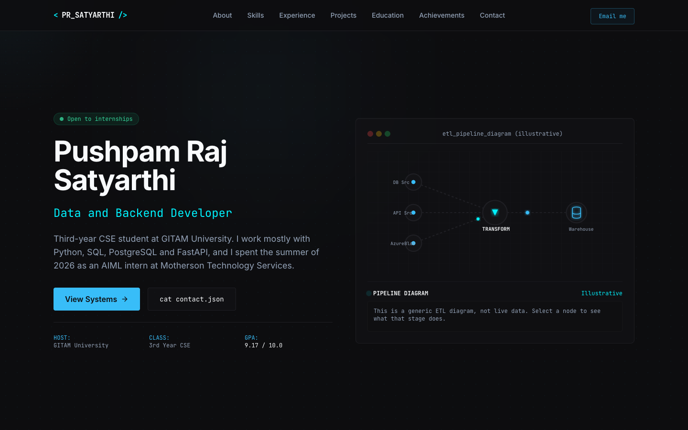
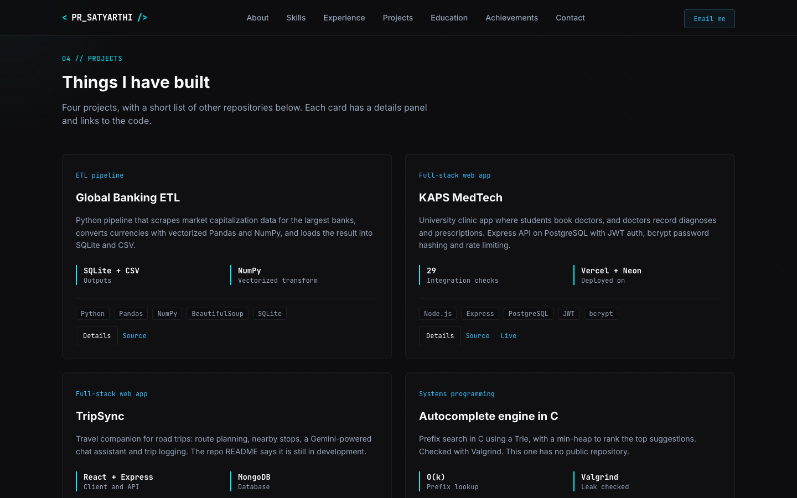
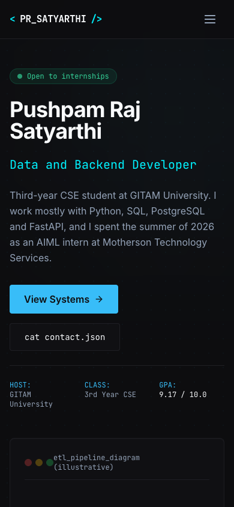

# Profile

My portfolio site: https://pushpam2404-profile.vercel.app

A static `index.html`. Styles are Tailwind CSS 3, compiled with the Tailwind CLI into `assets/tailwind.css`, which is committed, so Vercel serves the files as they are and needs no build command. Icons come from Lucide and fonts from Google Fonts. The JS and project data are inline in the HTML.



| Projects section | Mobile |
|---|---|
|  |  |

## Sections

About, skills, experience (one internship), projects, education and certification, two hackathon entries, and contact. The projects section has four cards with a details panel each, plus a short list of other repositories. Every link points to a repository or deployment that exists under github.com/pushpam2404.

## Running it locally

```bash
python3 -m http.server 8000
# open http://localhost:8000
```

To change styles, edit `src/input.css`, `tailwind.config.js` or the classes in `index.html`, then rebuild the stylesheet and commit it:

```bash
npm install
npm run build:css      # or npm run watch:css while editing
```

The build scans `index.html` for class names, so a class used only in another file would be dropped.

## Things on the page that do something

- The hero diagram is a generic ETL illustration. Clicking a node shows what that stage does. It is labelled as illustrative because it is not live data.
- The terminal accepts `help`, `cat about.md`, `get --skills`, `curl /experience`, `ls projects` and `clear`. Input is escaped before it is rendered.
- The project details panel reads from the JSON block with id `project-data`.
- The copy button in the contact section copies my email address.
- Motion respects `prefers-reduced-motion`.

## Accessibility and SEO

Skip link, a labelled mobile menu button with `aria-expanded`, visible focus outlines, keyboard-reachable project buttons, a details dialog that moves focus in and returns it on close, and Open Graph, Twitter and JSON-LD metadata with a 1200x630 preview image. Body text contrast is above 4.5:1 on the dark background.

## Editing

- Project cards: the Projects section in `index.html`.
- Details panels: the `project-data` JSON block.
- Terminal output: the `terminalCommands` object.
- Diagram text: the `nodeDetails` object.
- Colors and fonts: `tailwind.config.js`.
- Social preview image: `docs/social-preview.html` is the source. Render it at 1200x630 and copy the PNG to `assets/og.png` (served) and `docs/social-preview.png` (for uploading in the GitHub repo settings).

## Known limits

- `assets/tailwind.css` is generated, so it has to be rebuilt and committed after style changes.
- The GitHub repo social preview has to be uploaded by hand in the repo settings (no API). Use `docs/social-preview.png`.
- Some figures in the experience, about and hackathon sections (bugs found, endpoints, course count, hackathon results) come from me and cannot be checked from a public repository.
