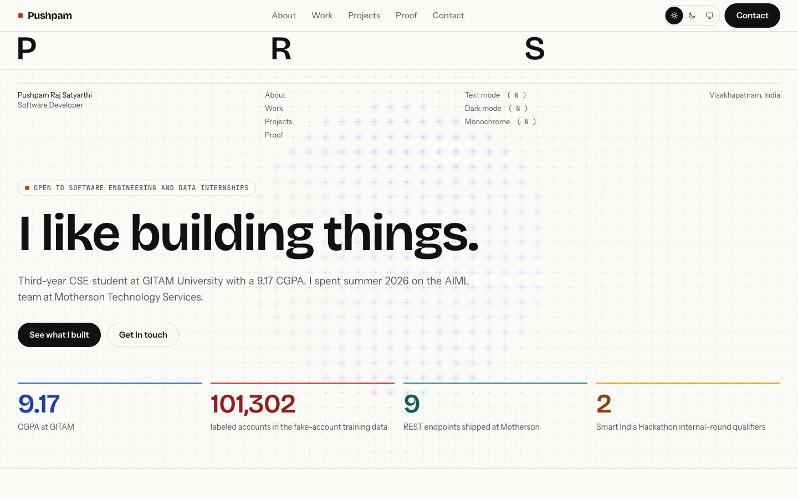
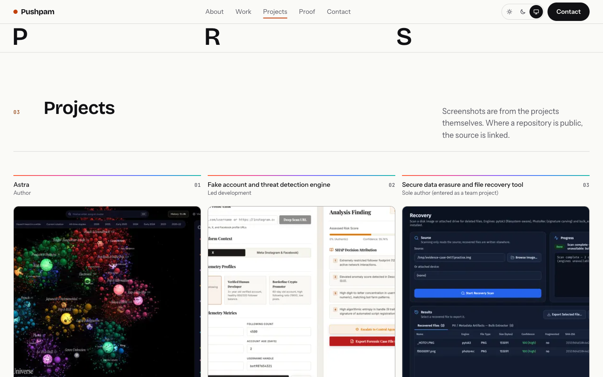
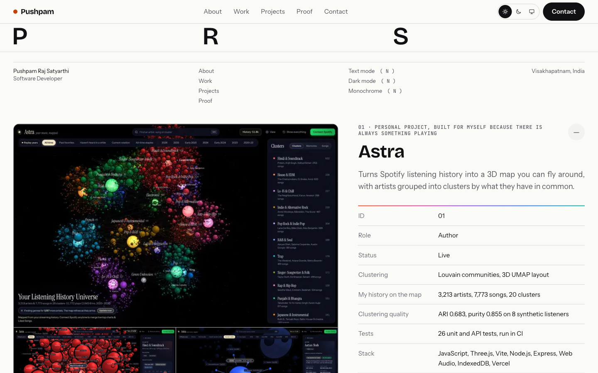
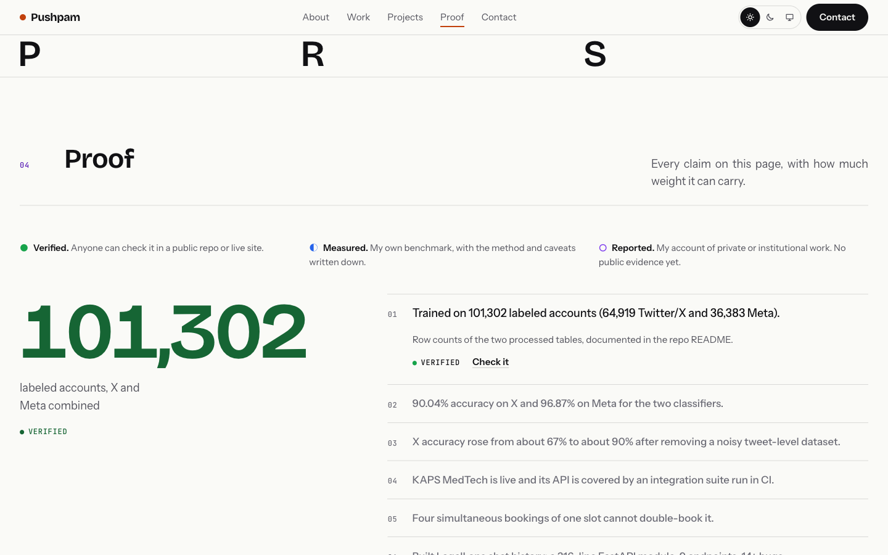
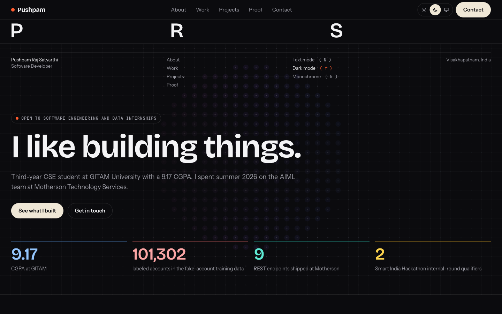
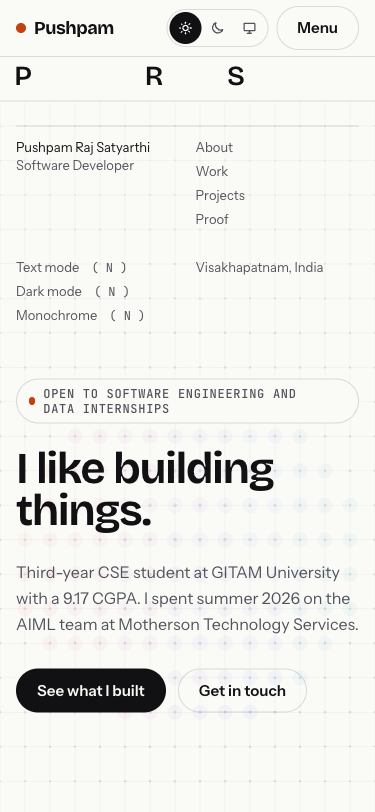

# Profile

My portfolio: https://pushpam2404-profile.vercel.app

Built with [Astro](https://astro.build) 7 and Tailwind CSS 4. No framework JavaScript ships to the browser: the scripts handle the theme switch, display modes, the proof list, the masthead and the hero mesh. Fonts are self-hosted through `@fontsource`.



| Projects | Project page |
|---|---|
|  |  |

| Proof | Dark mode | Mobile |
|---|---|---|
|  |  |  |

## What is on the site

| Section | What is in it |
|---|---|
| Masthead | A compact bar under the nav on every page with my initials. Hover (or tap on a phone) and it spells the name out |
| Hero | The headline, a line about me and four numbers that can each be checked, over a living dot mesh |
| 01 Who I am | About, leadership and community, education, and a figure of the three layers I work in |
| 02 Work | The Motherson internship and the toolbox |
| 03 Projects | Seven projects as cards with their own pages under `/projects/<name>/`, plus a list of smaller work |
| 04 Proof | Every claim with its evidence and a status. Also the IBM course certificates and hackathons |
| 05 Contact | Email, LinkedIn, GitHub, phone |

Keyboard shortcuts: **T** text mode (swaps pictures for flat tiles), **D** dark mode, **M** monochrome.

## Running it

```bash
npm install
npm run dev        # http://localhost:4321
npm run build      # runs `astro check` first, then builds to dist/
npm run preview    # serve the production build
```

Node 22.23.4 or newer.

## Editing content

Nothing is hard-coded in the components.

- Projects: one YAML file each in `src/content/projects/`. The schema is `src/content.config.ts`, so a missing field fails the build. A project without a public link has `repo: null`.
- Screenshots: `src/assets/projects/<project-name>/`, listed in order under `shots:` in the project's YAML with alt text. The first one is the card picture. They are real screenshots only, taken from the live sites or local runs with demo data.
- Everything else (hero numbers, experience, education, skills, leadership, proof table, other repositories): `src/data/site.ts`.
- Colors, type scale and motion tokens: `src/styles/global.css`. The design rules are in `docs/DESIGN_SYSTEM.md` and `CLAUDE.md`.
- `TODO` comments mark gaps that need information only I have.

## Proof statuses

- **Verified**: anyone can check it in a public repository or live site.
- **Measured**: my own benchmark, with the method written down.
- **Reported**: my account of private or institutional work, with no public evidence yet.

## Deploying

Vercel builds with `vercel.json` (`framework: astro`, `npm run build`, output `dist`). Every push to `main` deploys in about a minute.

## Screenshots and the social preview

- The pictures in `docs/screenshots/` come from the running site at 1440 px (375 px for mobile).
- `docs/social-preview.html` is the source for `public/og.png`. Open it at 1200x630, screenshot it, and copy the PNG to `public/og.png` and `docs/social-preview.png`.
